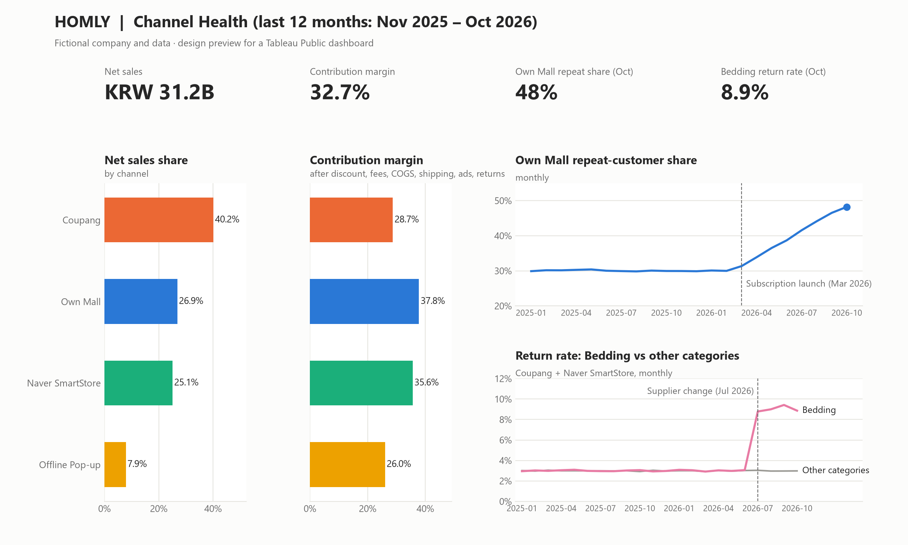

# HOMLY: Second-Meeting Tableau Demo Plan (Sample)

A sample plan for a second sales meeting with a fictional Korean SMB (a home-living brand with about 120 employees): qualify the deal, demo a dashboard built from the customer's own channel data, handle objections, and agree on a two-week trial with a decision date (2 pages, English and Korean).

- [English PDF](HOMLY_Tableau_Demo_Plan_EN.pdf)
- [한국어 PDF](HOMLY_Tableau_Demo_Plan_KR.pdf)

*Design mockup made with Python from the fictional data below. The Tableau Public version is being built and will be linked here.*

## What's inside
1. Account snapshot: channels, path so far (webinar lead → discovery call → shared 12 months of channel exports), meeting attendees
2. Qualification table: what the discovery call confirmed (pain, decision maker, alternatives, users) and the questions to close the gaps (budget, timing, approval steps)
3. 20-minute demo in five scenes, with AE/SE ownership: one-screen KPIs, "#1 in sales is not #1 in profit" by channel, did the subscription launch work, early warning on returns, and an optional AI question
4. Four expected objections ("Excel is enough", another BI tool, no data person, no budget) and how to answer them
5. Mutual action plan (Day 1 → Day 21), trial success criteria, and an example opportunity record (stage, close date, forecast category)

## Data
- `data/homly_sales_daily.csv`: synthetic daily sales, Jan 2025 – Oct 2026, 4 channels × 5 categories (13,380 rows): orders, units, gross and net sales, discounts, channel fees, COGS, shipping, ad spend, returns, new and repeat customers
- `src/gen_data.py`: generates the data (seed 1116) with three planted stories: channel margin gap, repeat-customer lift after a subscription launch, and a returns spike after a supplier change
- `src/mock.py`: draws the dashboard mockup

HOMLY is a fictional company and all numbers are fictional. The sample contains no real customer data, pricing, or contract terms, and is not affiliated with any real company.
