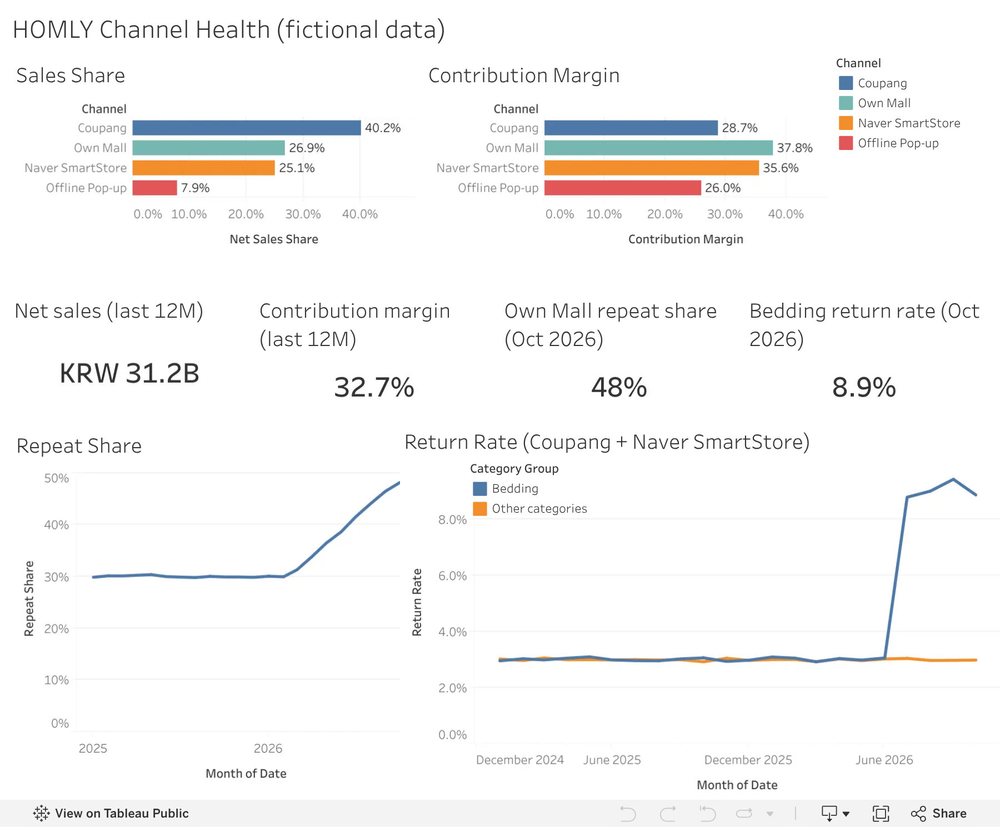

# HOMLY: Tableau 2차 미팅 시연 계획 샘플 (가상 데이터)

직원 약 120명 규모의 가상 리빙 브랜드 HOMLY를 상대로 한 Tableau 영업 샘플입니다. 1차 디스커버리 통화 뒤 고객이 공유한 채널별 정산 파일로 대시보드를 미리 만들어, 2차 미팅에서 "매출 1위 채널이 이익 1위는 아니다"를 고객의 숫자로 보여주고 2주 체험과 결정 일정에 합의하는 과정을 담았습니다.

- 대시보드(Tableau Public): [HOMLY Channel Health (fictional data)](https://public.tableau.com/app/profile/yooseop.seong/viz/HOMLYChannelHealthfictionaldata/HOMLYChannelHealthfictionaldata)
- 시연 계획서: [한국어 PDF](HOMLY_Tableau_Demo_Plan_KR.pdf) · [English PDF](HOMLY_Tableau_Demo_Plan_EN.pdf) (각 A4 2쪽)

## 영업 단계별로 담은 내용

| 단계 | 샘플에서 보여주는 것 |
|---|---|
| 리드·디스커버리 | 웨비나 참석 리드 → 마케팅팀장과 1차 통화 → 12개월 채널 정산 파일 확보 |
| 자격 확인 | 문제·결정권자·예산과 시점·대안·내부 지지자·사용자 규모·Salesforce 사용 7개 항목: 1차 통화에서 확인한 것과 2차 미팅에서 물을 질문 |
| 제품 시연 | 20분 5장면. AE가 장면 ①~④를 혼자 진행하고, SE는 데이터 연결과 AI 장면(Tableau Pulse, Salesforce 고객이면 Tableau Next)만 맡음 |
| 반론 대응 | "엑셀로 충분하다", "Microsoft BI도 검토 중", "데이터 담당자가 없다", "예산이 없다" |
| 체험·계약 | D+1 → D+21 공동 실행 계획, 체험 성공 기준 3개(주간 보고 취합 시간, 채널별 공헌이익 주간 확인, 대시보드로 바꾼 결정 1건) |
| 예측·기록 | Salesforce 기회 기록 예시: 단계·예상 마감일·예측 카테고리(Best Case → Commit)·금액·사용자(Creator 2·Viewer 8) |
| 확장 | 계약 후 3단계: 마케팅·재무·대표 → 3개월 뒤 MD·CS팀 반품·재고 화면 → 6개월 뒤 Salesforce CRM 연결 또는 Tableau Next 검토 |

## 대시보드 숫자 (최근 12개월, 2025.11 – 2026.10)
- 순매출 312억 원, 공헌이익률 32.7%
- 쿠팡 매출 비중 40.2%·공헌이익률 28.7% vs 자사몰 26.9%·37.8% (쿠팡 할인율 12%·수수료율 11%)
- 자사몰 재구매 고객 비중: 정기배송 도입(2026.3) 뒤 30% → 48%(2026.10)
- 쿠팡·스마트스토어 침구 반품률: 공급사 변경(2026.7) 전 월 3.0% 안팎 → 2026.10 8.9%

## 데이터와 재현
- `data/homly_sales_daily.csv`: 가상 일별 매출, 2025.01 – 2026.10, 채널 4 × 카테고리 5 (13,380행). 주문·수량·할인 전후 매출·할인·채널 수수료·원가·배송비·광고비·반품·신규/재구매 고객
- `data/gen_data.py`: 데이터 생성 스크립트(seed 1116). 채널 손익 차이, 정기배송 뒤 재구매 증가, 공급사 변경 뒤 반품 급증 세 가지 이야기를 심어 둠. 실행: `python gen_data.py homly_sales_daily.csv`
- Tableau 계산 필드(주요):
  - Contribution = net_sales − channel_fee − cogs − shipping − ad_spend − returns
  - Contribution Margin = SUM(Contribution) / SUM(net_sales)
  - Net Sales Share = SUM(net_sales) / TOTAL(SUM(net_sales))
  - Repeat Share = SUM(repeat_customers) / (SUM(new_customers) + SUM(repeat_customers))
  - Return Rate = SUM(returns) / SUM(net_sales), Category Group = 침구 vs 기타
  - KPI 타일 4개는 조건(최근 12개월, 자사몰·2026년 10월 등)을 계산식 안에 넣어 문자열로 표시

## 안내
HOMLY는 가상 회사이고 모든 숫자는 가상 데이터입니다. 실제 고객 데이터, Salesforce·Tableau 가격과 계약 조건은 담지 않았습니다. 개인 포트폴리오이며 Salesforce, Tableau와 제휴하거나 그 승인을 받은 자료가 아닙니다. Salesforce, Tableau는 Salesforce, Inc.의 상표입니다.

---

# HOMLY: Second-Meeting Tableau Demo Plan (Sample, fictional data)

A Tableau sales sample built around HOMLY, a fictional Korean home-living brand with about 120 employees. After a discovery call, the AE pre-builds a dashboard from the channel settlement files the customer shared, shows the CEO with HOMLY's own numbers that its #1 sales channel is not its #1 profit channel, and agrees on a two-week trial and a decision date.

- Dashboard (Tableau Public): [HOMLY Channel Health (fictional data)](https://public.tableau.com/app/profile/yooseop.seong/viz/HOMLYChannelHealthfictionaldata/HOMLYChannelHealthfictionaldata)
- Demo plan: [English PDF](HOMLY_Tableau_Demo_Plan_EN.pdf) · [Korean PDF](HOMLY_Tableau_Demo_Plan_KR.pdf) (2 A4 pages each)

| Sales stage | What the sample shows |
|---|---|
| Lead and discovery | Webinar lead → discovery call with the Head of Marketing → 12 months of channel settlement files |
| Qualification | Seven items (pain, decision maker, budget and timing, alternatives, champion, users, Salesforce use): what the call confirmed and what to ask next |
| Demo | 20 minutes, five scenes. The AE runs Scenes 1–4 alone; the SE handles only data connection and the AI scene (Tableau Pulse, or Tableau Next for Salesforce customers) |
| Objections | "Excel is enough", "We're also looking at Microsoft BI", "We have no data person", "No budget right now" |
| Trial and close | Day 1 → Day 21 mutual action plan and three trial success criteria |
| Forecast and record | Example Salesforce opportunity: stage, close date, forecast category (Best Case → Commit), amount, users (2 Creator, 8 Viewer) |
| Expansion | Three steps after the first contract: marketing, finance and CEO → merchandising and CS teams after 3 months → Salesforce CRM data or Tableau Next after 6 months |

Data: `data/homly_sales_daily.csv` (synthetic, Jan 2025 – Oct 2026, 13,380 rows) and `data/gen_data.py` (seed 1116).

HOMLY is a fictional company and all numbers are fictional. The sample contains no real customer data, Salesforce or Tableau pricing, or contract terms. It is a personal portfolio piece, not affiliated with or endorsed by Salesforce or Tableau. Salesforce and Tableau are trademarks of Salesforce, Inc.
